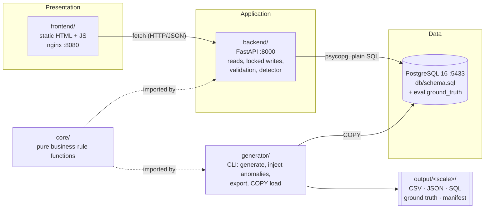

# Loyalty Ledger

A reproducible generator for a synthetic loyalty-points dataset, plus a small 3-tier app to explore it.

**What the generator does**
- **Builds the data:** customers and loyalty accounts, tiers and rules, orders and order lines, and a points ledger with accruals, reversals, redemptions and expiries.
- **Follows documented business rules:** see [docs/business_rules.md](docs/business_rules.md).
- **Injects labelled anomalies:** five types, with the labels kept in a separate ground-truth file.
- **Validates its own output:** with SQL checks.
- **Exports:** CSV, JSON and SQL.
- **Proves reproducibility:** the same seed gives byte-identical files.

**The app**
- A FastAPI backend that reads the ledger and accepts writes (orders, returns, redemptions, expiry runs) under row locks.
- A one-page frontend with a dashboard, account lookup, actions and an anomaly view.

## Architecture



- **The three tiers stay separate:**
  - the frontend talks only to the backend;
  - the backend is the only service that talks to the database.
- **`core/`** holds the rule arithmetic (points, reversals, FIFO consumption, expiry, tiers). It has no I/O, and both the generator and the API import it.
- **Validation and the detector** re-implement the rules independently in SQL, so they act as a second check on `core/` rather than reusing it.

## Quick start (Docker only)

You need Docker with Compose. Ports 5433, 8000 and 8080 must be free.

```bash
git clone https://github.com/sricharanreddy20/loyalty-ledger.git
```
```bash
cd loyalty-ledger
```
```bash
cp .env.example .env
```
```bash
docker compose up -d --build
```
```bash
docker compose run --rm backend python -m generator --scale starter --load
```

Then open:
- **http://localhost:8080:** the app.
- **http://localhost:8000/docs:** the API, with interactive docs.

Loading starter takes about 3 seconds. Any API write (redeem, return, expiry run) changes the database; run the last command again to reset it.

To stop the services:
```bash
docker compose down
```
To also delete the database volume:
```bash
docker compose down -v
```

## Generating the dataset

The generator is a single command. The seed is **20261022** by default, and the dataset covers calendar year 2026.

```bash
python -m generator --scale full --seed 20261022 --load --evaluate --check-reproducible
```

| Flag | What it does |
|---|---|
| `--scale starter\|full` | starter: 1,000 customers and 5,000 orders. full: 20,000 customers and 100,000 orders. Both use the same code. |
| `--seed N` | One `random.Random(seed)` drives everything. No clock, no `uuid4`, no global randomness. |
| `--out DIR` | Export folder (default `output/<scale>`). |
| `--load` | Recreates the schema and loads the export into PostgreSQL with COPY, in one transaction. Then checks row counts against the manifest. |
| `--evaluate` | After `--load`, runs validation and the detector. Writes `validation_summary.json/.md` and `anomaly_report.json/.md`. |
| `--check-reproducible` | Builds twice in separate processes with different `PYTHONHASHSEED` values and compares every file's SHA-256. |

Each export contains:
- `csv/`, `json/` and `sql/` (one file per table);
- `ground_truth.csv/json` (the anomaly labels, kept separate from the data);
- `manifest.json` (seed, scale, row counts, a SHA-256 per file, and a dataset fingerprint; no timestamps).

Inside Docker, put `docker compose run --rm backend` in front of the command.

## Business rules (summary)

Full details are in [docs/business_rules.md](docs/business_rules.md), the ERD and lifecycle states in [docs/erd.md](docs/erd.md), and every field in [docs/data_dictionary.md](docs/data_dictionary.md).

- **Tiers:** Bronze from ₹0 (1 point per ₹100 of eligible net spend), Silver from ₹25,000 (1.25), Gold from ₹75,000 (1.5), Platinum from ₹2,00,000 (2).
- **Earning:** points are earned per order line: floor(eligible net × rate / 100), at the tier in effect on the order date. Eligible net = unit price × quantity − discount. Gift cards, shipping and tax never earn.
- **Lots:** each accrual is a lot. It is **pending** for 30 days (the return window), **available** from day 31, and **expires** after 180 days.
- **Returns:**
  - full or partial, allowed up to and including day 30;
  - the reversal uses the original earn rate and references the original accrual;
  - several partial returns are handled cumulatively, so their total never exceeds what was earned.
- **Redemptions:**
  - approved only if the cost is within the available balance, otherwise rejected with INSUFFICIENT_POINTS;
  - they consume lots oldest-expiry first (FIFO), recorded in `redemption_lot`;
  - requests with the same timestamp are processed in (timestamp, ID) order.
- **Expiry:** a batch runs on the 1st of each month and expires every due lot that still has points. It is idempotent: a lot expires at most once.
- **Tier progression:**
  - qualifying spend = eligible net − returned amounts;
  - the check runs right after each order, and an upgrade takes effect the next day;
  - there are no downgrades in 2026.
- **Ledger and balances:** the ledger is append-only, and a balance is the sum of the ledger. `loyalty_account.current_balance` is a stored copy, and a validation check compares the two.

## Results (real runs, seed 20261022)

| | Starter | Full |
|---|---:|---:|
| Customers / accounts | 1,000 | 20,000 |
| Orders / order lines | 5,000 / 12,575 | 100,000 / 251,837 |
| Returns (line returns) | 953 | 18,689 |
| Redemptions approved / rejected | 455 / 159 | 9,546 / 3,109 |
| Tier changes | 505 | 9,553 |
| **Ledger rows** | **15,117** | **301,653** |
| · ACCRUAL | 11,952 | 239,281 |
| · REVERSAL | 943 | 18,633 |
| · REDEMPTION | 455 | 9,546 |
| · EXPIRY | 1,767 | 34,193 |
| Points outstanding (ledger sum) | 209,652 | 4,557,763 |
| Final tier mix (B / S / G / P) | 625 / 254 / 102 / 19 | 13,059 / 4,543 / 1,946 / 452 |
| Anomalies injected | 10 per type (50) | 50 per type (250) |
| Validation (39 checks) | 31 PASS · 8 EXPECTED_FAIL · 0 FAIL | 31 PASS · 8 EXPECTED_FAIL · 0 FAIL |
| Detector precision / recall / F1 (every type) | 1.0 / 1.0 / 1.0 | 1.0 / 1.0 / 1.0 |
| Reproducibility | all files identical | all files identical |

**What the validation counts mean**
- **EXPECTED_FAIL:** a check failed, and every violation is on an account carrying a labelled anomaly of the matching type. Each of the 8 such checks finds exactly 10 (starter) or 50 (full) violations, matching the ground truth.
- **FAIL:** a violation that no label explains. There are none.

**Full-scale timings (Apple Silicon laptop):**
- generate 7.5 s, export 15.2 s, load 19.1 s, evaluate 19.6 s;
- the whole command, including the double rebuild for the reproducibility check, took 107 s.

**Starter timings:**
- generate 0.3 s, export 0.7 s, load 1.4 s, evaluate 0.8 s.

The container (Python 3.12) and the host (Python 3.14) produce the same dataset fingerprint.

**Reports:**
- starter: [output/starter/validation_summary.md](output/starter/validation_summary.md) and [output/starter/anomaly_report.md](output/starter/anomaly_report.md);
- full: [output/full/validation_summary.md](output/full/validation_summary.md), [output/full/anomaly_report.md](output/full/anomaly_report.md) and [output/full/manifest.json](output/full/manifest.json). The full data files themselves are not committed (about 340 MB). Regenerate them with the command above.

## Design decisions

- **One ledger table** for all point movements, with typed references:
  - `reverses_pts_id` points from a REVERSAL to its accrual;
  - `expires_pts_id` points from an EXPIRY to its lot;
  - `rdm_id` links a REDEMPTION to its request.

  An ACCRUAL row is also the lot. A SQL function, `lot_status(as_of, account)`, derives the remaining points and status of each lot as of a date.
- **Points become available on day 31,** the day after the return window. So no redemption can ever spend points that a return could still reverse.
- **The schema enforces structure only** (keys, references, allowed values, signs, ID formats). Business rules are checked by validation SQL, so labelled anomalies can be loaded and then detected.
- **Validation and detection re-implement the rules in SQL,** independently of `core/`. Two implementations that agree are evidence that the rules are right.
- **The detector never reads the ground truth or ID gaps.** Only the scoring step reads `eval.ground_truth`. A test checks this.
- **Concurrency:** every API write locks the account row (`SELECT … FOR UPDATE`) inside one transaction. A test fires 10 simultaneous redemptions at a running server: exactly 1 is approved and 9 are rejected. Without the lock, all 10 are approved.
- **IDs come from PostgreSQL sequences** (`nextval` is atomic). The loader moves each sequence past the highest loaded ID.
- **The API can't rewrite history:** a write must be dated on or after both the latest expiry batch and the account's latest event.
- **Money uses `Decimal`** (2 decimals, rounded half-up), never floats. Points are integers.
- **Plain tools:** no ORM, plain SQL with psycopg 3, a standard-library generator, and a frontend with no build step.

## Assumptions

- The currency is INR, and everything happens in calendar year 2026. All timestamps are local, with no time zones.
- Each customer has exactly one loyalty account, opened on their signup date. Some members signed up in 2024–2025, but everyone starts 2026 at Bronze with no points.
- A tier upgrade applies to orders from the next day onwards. An upgrade earned on 31 Dec is effective on 1 Jan 2027.
- A rejected redemption is stored with status REJECTED and writes no ledger entry.
- Expiry IDs keep the 2026 prefix even for the 2027-01-01 batch: the year in an ID is the program year, not the run date.

## Known limitations

- **An upgrade is kept even if the order that earned it is returned,** including on the same day. Qualifying spend goes down, but the tier does not (no downgrades in 2026). Validation accepts a tier change if qualifying spend crossed the threshold at any moment before it took effect.
- **The 1.0 detector scores need context.** The detectors are rules written knowing the five injected anomaly types. The perfect score shows that they match those definitions exactly. It says nothing about how they would perform on unknown, real-world anomalies.
- **Not every "concurrent" redemption pair exceeds the balance when processed.** At full scale, the 200 same-timestamp pairs ended up as 135 approved+rejected, 46 rejected+rejected, 18 approved+approved and 1 rejected+approved. Each pair is still processed in (timestamp, ID) order. The approved+rejected case the rules call for is well covered.
- **The API can't back-date writes,** and after the 2027-01-01 expiry batch the 2026 write window is closed. Reload the data to start again.
- **No authentication;** the API is for local use.
- **The account ledger and lots tables are not paged:** an account's full history loads at once. (Account search is paged: it shows "Showing X of Y accounts" and loads 50 more at a time. `GET /accounts` takes `limit`/`offset` and returns the total in an `X-Total-Count` header.)

## Running the tests

The tests need a local Python 3.11+ virtual environment and the database container.

```bash
python3 -m venv .venv
```
```bash
.venv/bin/pip install -r requirements-dev.txt
```
```bash
docker compose up -d db
```
```bash
.venv/bin/python -m pytest -q
```

The suite has 165 tests:
- `core/` rule functions, ID formats, the generator, anomalies and exports;
- API reads and writes, the concurrency test against a real server, and expiry idempotency;
- validation and the detector, including a clean-baseline database, an unlabelled corruption and a check after API writes;
- the data dictionary against the database, and what may be committed.

The API tests use their own `loyalty_test` and `loyalty_test_clean` databases, so the development data is never touched. `RUN_DB_TESTS=1` also runs the loader test, which reloads the database that `DATABASE_URL` points to.

## Project structure

```
backend/      FastAPI app: db.py, models.py, reads.py, writes.py, queries.py, errors.py,
              sql_rules.py, validation.py, detector.py, evaluate.py; Dockerfile
core/         config.py (tiers, rules, dates), ids.py (ID formats), rules.py (pure rule functions)
db/           schema.sql (tables, constraints, indexes, sequences, lot_status), tests/smoke_test.sql
docs/         business_rules.md, erd.md (Mermaid), data_dictionary.md
frontend/     index.html, app.css, app.js, config.js (API address)
generator/    config.py, master.py, plan.py, simulate.py, anomalies.py, export.py, load.py, __main__.py
output/       starter/ (CSV, ground truth, manifest, reports); full/ (manifest and reports only)
tests/        unit tests; tests/api/ runs against PostgreSQL
docker-compose.yml   db, backend, frontend
```

## Data provenance

Every record is fully synthetic, and no external or real data is used.
- **Names and cities** are drawn from small built-in lists in `generator/master.py`.
- **Emails** use the reserved `example.com` domain.
- **All amounts, dates and events** come from the seeded random generator applying the documented rules.

## AI usage

Built with Claude Code. I made the design decisions and reviewed every step. I caught the day-30 return/redemption overlap; when the after-writes test exposed a tier-check inconsistency between the API and the generator, I chose the rule and the documented limitation.
