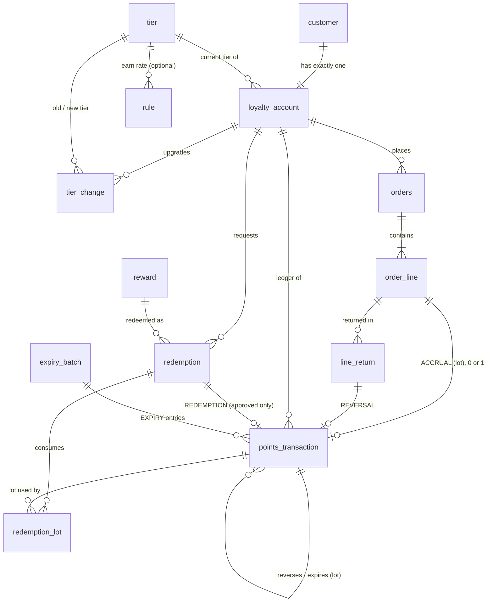

# Entity-relationship diagram

Source of truth: [`db/schema.sql`](../db/schema.sql).

## Cardinality notes
- **1:1** customer ↔ loyalty_account (`customer_id` is UNIQUE; `loy_id = 'LOY-' || customer_id`).
- **1:N** account → orders → order lines; account → ledger, redemptions, tier changes.
- **N:M** redemption ↔ lot, through the bridge table `redemption_lot` (`points_used` per pair).
- **Optional links**
  - A line with zero eligible points (for example a gift card) has no ACCRUAL.
  - A REJECTED redemption has no ledger entry and no `redemption_lot` rows.
  - `rule.tier_id` is set only for EARN_RATE rules, and `rule.category` only for CATEGORY_EXCLUSION rules.
- **Ledger references by type**

  | Type | Must reference |
  |---|---|
  | ACCRUAL | `line_id` |
  | REVERSAL | `reverses_pts_id` (the accrual) and `return_id` |
  | REDEMPTION | `rdm_id` |
  | EXPIRY | `exp_id` and `expires_pts_id` (the lot) |

- **Effective dates:** `rule.effective_from` / `effective_to` (NULL means open-ended) and `tier_change.effective_date`.
- **Evaluation table:** `eval.ground_truth` sits in its own schema and has no foreign keys to the input tables.

## Lifecycle states
| Entity | States | How it is recorded |
|---|---|---|
| Lot (ACCRUAL) | PENDING → AVAILABLE → PARTIAL → CONSUMED; or EXPIRED; or REVERSED | Derived by `lot_status(as_of)` from dates plus reversal, redemption and expiry records. No status column is stored, so the history can't be overwritten. |
| Order line | PURCHASED → PARTIALLY_RETURNED → RETURNED | Derived from the `line_return` rows (sum of `qty_returned` vs `qty`). |
| Redemption | APPROVED or REJECTED (with `reject_reason`) | Fixed when created. |
| Tier | BRONZE → SILVER → GOLD → PLATINUM (upgrades only) | One `tier_change` row per upgrade. `loyalty_account.tier_id` is the current tier. |
| Expiry batch | one per `run_date` (UNIQUE) | Re-running a date adds no new batch. |

`lot_status(as_of date DEFAULT '2026-12-31')` returns one row per lot earned on or before `as_of`. The columns are original, reversed, redeemed, expired, remaining and status. A lot that is past `expires_at` but not yet processed by a batch shows as EXPIRED and still has remaining points until the batch runs.
